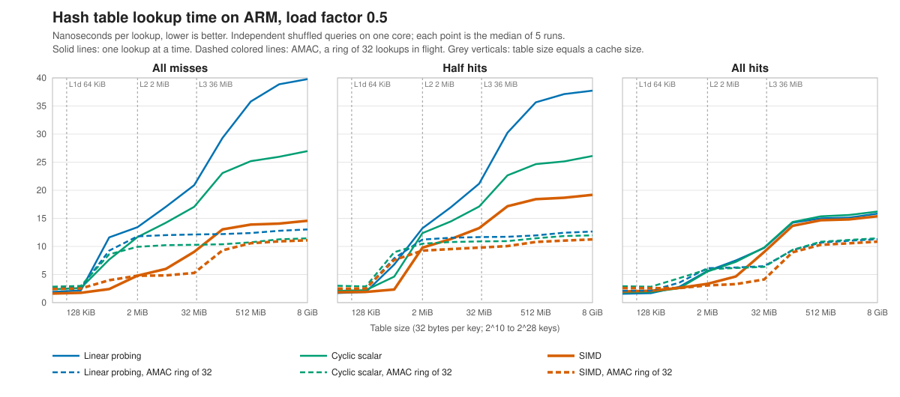
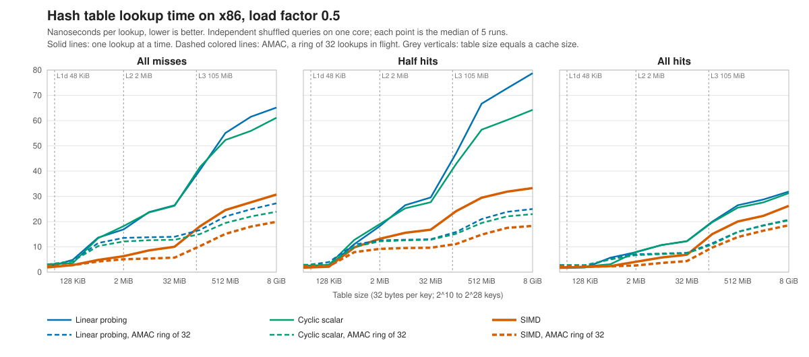

# simd-ht

simd-ht holds three open-addressing hash tables for 64-bit keys, and a benchmark that measures their lookups in tables far larger than the CPU caches. The benchmark starts from linear probing and tests two changes: a SIMD compare of the four keys in each cache line, and 32 lookups in flight at once with AMAC (asynchronous memory access chaining). In an 8 GiB table, the two changes together cut the time to find that a key is absent from 39.79 ns to 11.10 ns on ARM, and from 65.14 ns to 19.92 ns on x86.

Use it to measure these lookups on your own machine, or to read a short implementation of a SIMD group compare and of AMAC batching. It is not a general-purpose hash map. The tables are insert-only, take 64-bit keys and values, reserve key 0, and never get more than half full.

## Quick start

Every documented run used Linux. You need an AArch64 CPU, or an x86-64 CPU with AVX2. You also need Clang (tested with 22.1.8), Meson 1.3 or later, Ninja, CMake, clang-format and clang-tidy.

```sh
CXX=clang++-22 meson setup build --buildtype=release
meson compile -C build
meson test -C build
taskset -c 8 build/oa_bench --benchmark_filter='^(ScalarOA|SIMDGroupedOA)(_AMAC32)?/keys:16777216/hit_percent:0/'
```

The last command times linear probing and the SIMD lookup on a 512 MiB table where every lookup misses. Each runs one key at a time, and again with 32 lookups in flight at once. The run takes about 10 seconds. `taskset -c 8` pins the process to CPU 8; any idle CPU works. The [worked example](#worked-example-six-lookups-on-a-512-mib-table) explains the output. [Build, test and run](#build-test-and-run) lists every prerequisite, option and error message.

## A miss compares 2.5 keys and still takes 39.79 ns

Take 2^28 distinct random 64-bit keys in an open-addressing table at load factor 0.5. The table takes 8 GiB, far more than the 36 MiB L3 cache of the ARM machines used here or the 105 MiB L3 cache of the x86 machines. Now look up 2^28 other keys in shuffled order, none of them in the table. The lookups do not depend on each other, so the number that matters is throughput on one thread, not the latency of one lookup. The probe phase of a hash join looks like this. The batched lookups here are adapted from the ClickHouse hash join ([ClickHouse#115254](https://github.com/ClickHouse/ClickHouse/pull/115254)).

Linear probing (`ScalarOA`) is the baseline. It stores 16-byte cells, four to a 64-byte cache line. A lookup starts at the cell the hash selects and tries each next cell, until it finds the key or an empty cell. Keys and values sit in the table itself, with no buckets, and key 0 marks an empty cell.

```text
Linear probing: 16-byte cells, four per 64-byte cache line
  | key | value | key | value | key | value | key | value |
  start at cell  hash & (capacity - 1),  then try the next cell
```

At load factor 0.5, a miss compares 2.5 keys on average (Knuth, *The Art of Computer Programming*, Vol. 3, §6.4). That sounds cheap. In the 8 GiB table, a miss takes 39.79 ns on ARM, or 108.7 cycles, and 65.14 ns on x86. The hardware counters on ARM split that time into three costs:

- **Cache lines.** A run of filled cells can carry a miss into the next cache line. A miss reads 1.375 lines on average, and 28% of misses read two or more.
- **Branch mispredictions.** Half of all misses stop at the first cell, and 13.6% need five or more. So the branch that ends the loop is hard to predict: a miss mispredicts 1.412 times.
- **Memory waits.** Each lookup waits for its cache line by itself. The core can start later, independent lookups during the wait, but only up to its out-of-order window: a limit on how many later instructions it may start.

Each cost has a known remedy, and each remedy alone leaves the other costs in place. One remedy packs four keys into each cache line and compares them with one SIMD instruction. That removes most of the mispredictions: a SIMD lookup that builds one mask bit per key cut them to 0.25 per miss. But it ran 45.17 instructions per miss, and it was 6% slower than a scalar scan of the same layout.

The faster SIMD lookup described below still spends 40.5 cycles on a miss. A large part of that is memory waits that the out-of-order window does not hide. Batching the lookups in software hides those waits. But on ARM it also raises the instruction count by 56% to 82%, and on the smallest tables it loses to looking up one key at a time.

This project combines a cheap SIMD probe with batching, and measures where the combination pays and where it does not.

## The approach: a cheaper probe, and many probes in flight

The design makes two changes. The first makes each probe cheaper. The second runs many probes at once, so that their memory waits overlap.

### Four keys in one cache line, tested with one branch

```text
Grouped: one 64-byte group per cache line
  | key 0 | key 1 | key 2 | key 3 | value 0 | value 1 | value 2 | value 3 |
  start at group  (hash & (capacity - 1)) / 4,  then try the next group
```

A group fills exactly one 64-byte cache line: four keys, then their four values. The four key positions are called lanes, numbered 0 to 3. Each key and its value still take 16 bytes, and the same hash bits pick their position. So a probe lands on the same cache line as in linear probing, and a group never straddles two lines.

A lookup starts at the group the hash selects, called its home group. If it finds neither its key nor an empty lane there, it moves on to the next group. A miss reads 1.228 cache lines instead of 1.375.

The SIMD grouped lookup (`SIMDGroupedOA`) compares all four keys at once, with NEON on ARM or AVX2 on x86. One branch then tests whether any key matched. A miss mispredicts 0.284 times, against 1.412 for linear probing, and runs 28.97 instructions, against 28.50 (ARM, 8 GiB).

A third design keeps the groups and drops the SIMD compare. The cyclic scalar scan (`ScalarCyclicGroupedOA`) checks one key at a time. It starts at lane `hash & 3` and wraps from lane 3 to lane 0.

### A ring of lookups whose memory waits overlap

AMAC overlaps the memory waits in software, instead of leaving that to the core (Kocberber, Falsafi and Grot, "Asynchronous Memory Access Chaining", PVLDB 9(4):252-263, 2015, [doi:10.14778/2856318.2856321](https://doi.org/10.14778/2856318.2856321)). The code keeps R lookups in flight: each has started, and none has finished. They sit in the R slots of a ring, and the code visits the slots in turn.

A visit reads one cache line, the line that the slot prefetched earlier. If the visit finishes the lookup, the slot takes the next key of the batch and prefetches that key's first line. Otherwise the slot prefetches the line for its next visit. While one line is on its way from memory, the visits to the other slots run.

```text
ring of R slots, each holding   position (the line it reads next), key
sweep over the slots, one visit each:
    visit   read the line at the slot's position
            key found, or empty slot found -> result goes out, slot takes the next key, prefetch its first line
            otherwise                      -> position = next line, prefetch it
```

R is 32 at every table size, and rings of 8, 16 and 64 also run at 2^24 and 2^28 keys. Each of the three designs has an AMAC version. It makes the same compare as the one-at-a-time lookup, one cache line per visit.

The two changes work on different costs. SIMD works on instructions and branches. AMAC works on the overlap of memory waits. On ARM, SIMD with AMAC runs 62% more instructions than SIMD alone, and takes 24% fewer cycles.

### How the code fits together

The tables are header-only C++20. A benchmark program, a test program and three analysis tools sit around them.

- `src/hash_tables.hpp` holds the three tables. Each has `insert`, a lookup for one key, and an AMAC lookup for a batch of keys.
- `src/amac.hpp` holds `amacRun`, the ring that drives every AMAC lookup. Each table supplies a policy with two functions. `start` puts a key into a slot and prefetches the first cache line that the key needs. `step` makes one visit.
- `src/benchmark.cpp` and `src/workload.hpp` make up `oa_bench`, the Google Benchmark program. It builds a table and the list of keys to look up, called the query trace. Then it times the lookups and checks the results.
- `src/perf_counters.hpp` reads hardware counters when `OA_PMU=1` is set.
- `tests/hash_tables_test.cpp` is `oa_tests`, the correctness tests.
- `tools/probe_stats.cpp` is `oa_probe_stats`. It counts key compares and cache lines by replaying the lookups.
- `tools/summarize.py` and `tools/plot.py` turn the benchmark JSON into the tables and charts of this page and of [RESULTS.md](RESULTS.md).

| Design | Table class | One key | A batch, ring of R | Benchmark names |
| --- | --- | --- | --- | --- |
| Linear probing | `ScalarTable` | `find` | `findAmac<R>` | `ScalarOA`, `ScalarOA_AMAC32` |
| Cyclic scalar scan | `CyclicGroupedTable` | `findScalar` | `findScalarAmac<R>` | `ScalarCyclicGroupedOA`, `ScalarCyclicGroupedOA_AMAC32` |
| SIMD grouped lookup | `GroupedTable` | `findSimd` | `findSimdAmac<R>` | `SIMDGroupedOA`, `SIMDGroupedOA_AMAC32` |

The rings of 8, 16 and 64 run as `_AMAC8`, `_AMAC16` and `_AMAC64`. A lookup returns a pointer to the value, or `nullptr` when the key is absent. This program uses the SIMD table both ways:

```cpp
#include "hash_tables.hpp"

#include <iostream>
#include <vector>

int main()
{
    simd_ht::GroupedTable table(1024); // room for 1,024 distinct keys at load factor 0.5
    table.insert(11, 110);
    table.insert(22, 220);
    table.insert(33, 330);

    std::cout << "findSimd(22) = " << *table.findSimd(22) << '\n';

    const std::vector<simd_ht::Key> batch{11, 44, 33, 22};
    table.findSimdAmac<32>(batch, [&](size_t row, const simd_ht::Value * value)
    {
        std::cout << "row " << row << ": key " << batch[row] << " -> ";
        if (value)
            std::cout << *value << '\n';
        else
            std::cout << "absent\n";
    });
}
```

```sh
clang++-22 -std=c++20 -O2 -DSIMD_HT_NEON64=1 -Isrc example.cpp -o example        # AArch64
clang++-22 -std=c++20 -O2 -DSIMD_HT_AVX2=1 -mavx2 -Isrc example.cpp -o example  # x86-64
./example
```

```text
findSimd(22) = 220
row 0: key 11 -> 110
row 1: key 44 -> absent
row 2: key 33 -> 330
row 3: key 22 -> 220
```

The batched lookup calls the callback once per key, in the order the lookups finish. A callback that takes `(row, value)` gets the key's index in the batch as `row`. Here every lookup finishes on its first visit, so the results happen to come out in batch order. A callback that takes only `value` is also accepted, and the ring then stores no indices. The benchmark uses that form, because it only sums the values.

`insert` throws `std::invalid_argument` for key 0, and `std::length_error` when the table is already half full. Inserting a key that is already present overwrites its value. Meson sets the SIMD backend for its own targets. Outside Meson, define the backend yourself, as in the commands above. Without a definition, the header stops with `#error "Select the NEON64 or AVX2 SIMD backend in Meson."`.

## Worked example: six lookups on a 512 MiB table

This example measures one table size from start to finish. It uses 2^24 keys, so the table takes 512 MiB, more than the L3 cache of either test machine. It runs the three designs one key at a time and with a ring of 32, with 0%, 50% and 100% of the lookups hitting.

First build and test with the three Meson commands of the [quick start](#quick-start). On the first setup, Meson downloads Google Benchmark 1.9.4 and checks the hash of the archive. `meson test` runs four tests and ends with `Ok: 4` and `Fail: 0`:

- `hash_tables`: the table tests.
- `hash_tables_avx2_source` on ARM, or `hash_tables_neon64_source` on x86: the same tests, built from the other CPU's SIMD source.
- `probe_stats_placement`: a check that the probe-statistics replay places every key where the real tables do.
- `benchmark_smoke`: a short run of the six lookups at 1,024 keys.

Then run the 18 cases of one table size. A case is one lookup design at one hit rate.

```sh
taskset -c 8 build/oa_bench \
    --benchmark_filter='^(ScalarOA|ScalarCyclicGroupedOA|SIMDGroupedOA)(_AMAC32)?/keys:16777216/' \
    --benchmark_min_time=0.1s --benchmark_min_warmup_time=0.05 \
    --benchmark_repetitions=5 --benchmark_enable_random_interleaving=true \
    --benchmark_display_aggregates_only=true \
    --benchmark_out=row.json --benchmark_out_format=json
```

- The filter is a regular expression over the benchmark names. A name has the form `SIMDGroupedOA_AMAC32/keys:16777216/hit_percent:0/real_time`. This filter selects six lookups at three hit rates.
- Each case builds its table and its shuffled query trace before the timer starts. One timed pass looks up every key of the trace and sums the values it finds. Google Benchmark counts each lookup as one iteration, so every time is per lookup.
- Each case runs five times, and the 90 runs go in one random order. After timing, each case checks its hit count and value checksum, and fails on a mismatch.
- The run needs about 650 MiB of memory. It took 2 minutes 11 seconds on the shared ARM development machine (`m8g.24xlarge`).

The console shows four lines per case: the mean, median, standard deviation and coefficient of variation (`cv`) of the five runs. Here are three of the median lines from the published ARM run (`m8g.4xlarge`), for the cases where every lookup misses. Each line is cut after `items_per_second`:

```text
Benchmark                                                                            Time             CPU   Iterations UserCounters...
ScalarOA/keys:16777216/hit_percent:0/real_time_median                             35.8 ns         35.8 ns            5 capacity=33.5544M items_per_second=27.9371M/s ...
SIMDGroupedOA/keys:16777216/hit_percent:0/real_time_median                        13.9 ns         13.9 ns            5 capacity=33.5544M items_per_second=71.9999M/s ...
SIMDGroupedOA_AMAC32/keys:16777216/hit_percent:0/real_time_median                 10.6 ns         10.6 ns            5 capacity=33.5544M items_per_second=94.5769M/s ...
```

`Time` is nanoseconds per lookup. On these summary lines, `Iterations` is the number of runs. The counters after it give the number of slots in the table, the lookups per second, the load factor, and the bytes of the trace and of the table.

`tools/summarize.py` turns the JSON into Markdown tables. They hold the medians, the factors between them, and the largest run-to-run variation:

```sh
python3 tools/summarize.py row.json
```

For the published data of the same 18 cases, its first table looks like this on ARM. Each number is the median nanoseconds per lookup, and bold marks the lowest in its row.

| Keys | Table | Hits | Linear probing | Cyclic scalar | SIMD | Linear probing, AMAC | Cyclic scalar, AMAC | SIMD, AMAC |
| --- | --- | ---: | ---: | ---: | ---: | ---: | ---: | ---: |
| 2^24 | 512 MiB | 0% | 35.79 | 25.19 | 13.89 | 12.39 | 10.73 | **10.57** |
| 2^24 | 512 MiB | 50% | 35.65 | 24.66 | 18.41 | 11.96 | 11.45 | **10.79** |
| 2^24 | 512 MiB | 100% | 15.00 | 15.37 | 14.67 | 10.68 | 10.84 | **10.29** |

On x86 it looks like this:

| Keys | Table | Hits | Linear probing | Cyclic scalar | SIMD | Linear probing, AMAC | Cyclic scalar, AMAC | SIMD, AMAC |
| --- | --- | ---: | ---: | ---: | ---: | ---: | ---: | ---: |
| 2^24 | 512 MiB | 0% | 55.10 | 52.31 | 24.59 | 22.05 | 19.47 | **15.15** |
| 2^24 | 512 MiB | 50% | 66.69 | 56.40 | 29.47 | 20.98 | 19.45 | **14.86** |
| 2^24 | 512 MiB | 100% | 26.48 | 25.53 | 20.05 | 15.96 | 15.89 | **13.90** |

Read the row where every lookup misses. On ARM, SIMD alone is 2.58 times faster than linear probing. Linear probing with AMAC is 2.89 times faster, and SIMD with AMAC 3.39 times. On x86 the factors are 2.24, 2.50 and 3.64. SIMD with AMAC has the lowest median at all three hit rates on both machines.

Expect your own times to differ. Two runs of the same one-at-a-time code on the same instance type differed by up to 11.6% (see [RESULTS.md](RESULTS.md#the-two-runs-gave-different-one-at-a-time-times)).

`summarize.py` needs all three hit rates of a table size, and `plot.py` needs more than one table size. The [full sweep](#run-the-benchmark) gives both.

## How it works

The worked example showed both changes paying off. This section explains the mechanism behind each, and the problems that came up in adapting AMAC to these tables.

### The cyclic scan starts at lane `hash & 3`, so the first compare finds most hits

Take a scalar scan that starts at lane 0. Insertion puts each key in the lowest free lane, so a key can sit in any lane. The first compare then finds only 43% of hits, where linear probing finds 75%. A miss compares all four lanes before it checks for an empty one, so it makes 4.91 compares on average. The [step table](#either-change-alone-gives-most-of-the-gain-on-misses) lists this design as step 2.

The cyclic scan starts both insertion and lookup at lane `hash & 3`, and wraps inside the group. The first compare then finds 75% of hits. Insertion fills the lanes in the order the lookup scans them, and the table never deletes a key. So the lookup can stop at the first empty lane, and a miss compares 2.56 keys.

### One branch tests four keys, because a key sits in at most one lane

Comparing four keys at once leaves four results to turn into one branch. One mask bit per lane takes 8 instructions per group. The lookup then builds a second mask to find an empty lane, so a miss runs 45.17 instructions. Two facts about the table allow a cheaper test:

- A key sits in at most one slot, so at most one lane can match.
- Insertion fills the lowest free lane and nothing is ever deleted, so a group with any free lane has lane 3 free.

The first fact removes the need for a separate bit per lane. Two `cmeq` instructions compare keys 0-1 and keys 2-3. `uzp1` keeps one 32-bit half of each compare result, and `xtn` narrows that half to 16 bits per key, in one register. One branch then tests all four keys. Clang 22 generates these instructions for one group:

```asm
ldp   q1, q2, [x15]          // load keys 0-1 and keys 2-3
cmeq  v1.2d, v1.2d, v0.2d    // keys 0-1 == search key: all ones or all zeros per lane
cmeq  v2.2d, v2.2d, v0.2d    // keys 2-3 == search key
uzp1  v1.4s, v1.4s, v2.4s    // keep one 32-bit half of each result
xtn   v1.4h, v1.4s           // narrow to one 16-bit field per key
fmov  x14, d1                // move the four fields to one general register
cbnz  x14, hit               // one branch for four keys
```

A match in lane `i` leaves `48 - 16 * i` leading zeros in that register. The values sit in order, 8 bytes each. So half the leading-zero count is the distance in bytes from value 3 back to value `i`. Here the search key is in lane 1:

```text
keys        | k0     | k1     | k2     | 0      |   search key k1
cmeq        | 0      | ones   | 0      | 0      |   64 bits per lane
narrowed    | 0x0000 | 0xffff | 0x0000 | 0x0000 |   16 bits per lane, lane 0 lowest
clz         32                                      48 - 16 * 1
value       &values[3] - 32 / 2 bytes  =  &values[1]
```

The second fact gives the test for a miss. When no lane matches, the lookup reads `keys[3]`, and a 0 there means the key is absent. Of all groups, 83.7% are not full, so this branch nearly always goes the same way.

A hit that stops in its home group runs 29 instructions, and a miss that stops there runs 26. Both counts include the hash and the benchmark loop. Each further full group adds 13 instructions. A miss reads 1.2284 groups on average, so these path lengths give 26 + 0.2284 x 13 = 28.97 instructions per miss. The counters measured 28.97.

On x86-64, one `vpcmpeqq` compares all four keys, and `vmovmskpd` moves the result to a general-purpose register. There I keep the probe position as a byte offset, because x86 addressing cannot scale a group index by 64. Each further full group then costs 9 instructions.

The code is in [`src/hash_tables.hpp`](src/hash_tables.hpp) and [`src/amac.hpp`](src/amac.hpp). It uses only the vector types built into Clang, with no separate SIMD library. That lets the tests build the other CPU's SIMD source and run it on the local CPU.

### A ring of two slots shows how AMAC overlaps the waits

The smallest ring that shows AMAC has two slots. Keys A, B and C go through it on the SIMD table. A's home group g7 is full, so A is in g8. B is in its home group g2. C is absent, and its home group g5 has a free lane 3. A `<==` marks what changed at each stage.

```text
1. Fill the ring. Each slot hashes its key and prefetches the key's home group.
   keys left   C
   slot 0      A -> g7     prefetch g7                       <==
   slot 1      B -> g2     prefetch g2                       <==
```

Both lines are now in flight. With 32 slots, 32 are.

```text
2. Sweep 1, slot 0. Visit g7: no key matches and lane 3 is full. A moves on and prefetches g8.
   slot 0      A -> g8     prefetch g8                       <==
   slot 1      B -> g2
```

```text
3. Sweep 1, slot 1. Visit g2: B matches, and B's result goes out. Slot 1 takes C and prefetches g5.
   slot 0      A -> g8
   slot 1      C -> g5     prefetch g5                       <==
   results     B                                             <==
```

```text
4. Sweep 2, slot 0. Visit g8: A matches, and A's result goes out. No key is left, so the slot stays empty.
   slot 0      empty                                         <==
   slot 1      C -> g5
   results     B, A                                          <==
```

```text
5. Sweep 2, slot 1. Visit g5: no key matches and lane 3 is empty, so C is absent. The null result goes out.
   slot 0      empty
   slot 1      empty                                         <==
   results     B, A, C(absent)                               <==
```

The batch was A, B, C, and the results came out as B, A, C, in the order the lookups finished.

With 32 slots, the same loop runs for every lookup. Below is the loop of the SIMD lookup while all 32 slots are busy. It comes from the disassembly of the ARM binary (`llvm-objdump-22 -d --no-show-raw-insn -C build/oa_bench`).

The loop has no calls. It issues one `prfm` for each lookup it starts and for each visit that moves on. The hit count and the checksum stay in registers. Each slot holds a position and a key, but no batch index.

```asm
loop:
  lsl   x18, x15, #3               // slot s, as a byte offset
  ldr   x11, [x24, x18]            // ring.pos[s]: the group to read
  add   x18, x27, x18              // &ring.key[s]
  ld1r  {v1.2d}, [x18]             // broadcast the key
  ldp   q2, q0, [x11]              // keys 0-1 and 2-3, prefetched by an earlier visit
  cmeq  v2.2d, v2.2d, v1.2d
  cmeq  v1.2d, v0.2d, v1.2d
  uzp1  v1.4s, v2.4s, v1.4s
  xtn   v1.4h, v1.4s
  fmov  x18, d1
  cbz   x18, no_match              // one branch for four keys
  ...                              // hit: clz, sub, ldr, two adds (hit count, checksum), then the next key
no_match:
  mov   x18, v0.d[1]               // keys[3]
  cbz   x18, absent                // lane 3 empty: the key is absent, take the next key
  add   x11, x11, #0x40            // next group
  cmp   x11, x9                    // wrap at the end of the table
  csel  x11, x8, x11, eq
  str   x11, [x24, x15, lsl #3]    // ring.pos[s] = next group
  prfm  pldl1keep, [x11]           // prefetch it
  add   x15, x15, #0x1             // next slot
  cmp   x15, #0x20                 // 32 slots
  b.ne  loop
```

A visit that moves on to the next group runs 21 instructions. A visit that finds the key runs 45, and one that finds an empty lane 3 runs 42. Both of these include the start of the next lookup. For comparison, a hit in the one-at-a-time SIMD lookup runs 29.

These path lengths model the instruction count of the ring. A miss makes 1.2284 visits, so the model gives 42 + 0.2284 x 21 = 46.80 instructions per lookup. The counters measured 47.02.

### Adapting AMAC to these tables raised four problems

The first problem is the number of visits. This code is adapted from the ClickHouse hash join ([ClickHouse#115254](https://github.com/ClickHouse/ClickHouse/pull/115254), with the ring in [ClickHouse#120515](https://github.com/ClickHouse/ClickHouse/pull/120515)). That join makes one visit per cell. Linear probing compares 2.50 keys per miss, so a visit per cell would make 2.50 visits.

Here a visit reads the rest of its cache line, from the current cell to the next 64-byte boundary, so a miss makes 1.375 visits. A test checks that the cells start on a 64-byte boundary. The repo has no one-cell variant, so I have no measurement of one.

The second problem is a wasted store. A ring that keeps each lookup's batch index pays for a store that a summing callback never reads. A callback that takes only the value makes the ring skip the index (`amac_tracks_rows` in `src/hash_tables.hpp`). Clang does not remove the dead stores by itself. In a separate compile of both forms, the form with the index has one more store each time a lookup starts. I did not time the difference.

The third problem is two edge cases: the end of the table, and key 0. A walk can run past the end of the table. A visit that reaches the end wraps its position to the start; that is the `csel` in the listing. Key 0 marks an empty slot, so a lookup of key 0 would match one. For that reason, key 0 never enters the ring: its result is null at once, and the slot stays free for the next key. The tests cover wraparound and key 0.

The fourth problem is the order of the results: they come out as the lookups finish. A callback that takes the index and the value can put each result in its place. A callback that takes only the value gets no index. The benchmark uses that form, because it only sums the values.

The prefetch must also bring the line all the way to L1. The code uses `__builtin_prefetch(address, 0, 3)`, and on ARM Clang compiles that to `prfm pldl1keep`. Locality 1 would compile to `prfm pldl3keep` and bring the line only as far as L3. I did not time that variant.

## Results: SIMD with AMAC has the lowest median from 2 MiB up on ARM and from 512 KiB up on x86

The mechanisms above predict which costs each change removes. This section shows how much time that saves, where it saves nothing, and how the numbers were taken.

### How the numbers were measured

The main run used AWS instances in `ap-south-2a` that ran nothing but this benchmark. Both platforms ran the same source, and each platform used one binary, copied unchanged to its four instances. Each instance is part of a larger processor, so other tenants can share its L3 cache and its memory bandwidth.

| | ARM | x86 |
| --- | --- | --- |
| Instances | 4 x `m8g.4xlarge` | 4 x `m7i.4xlarge` |
| CPU | Arm Neoverse V2, NEON | Intel Xeon Platinum 8488C, AVX2 |
| Caches | 64 KiB L1d and 2 MiB L2 per core, 36 MiB L3 | 48 KiB L1d and 2 MiB L2 per core, 105 MiB L3 |
| Compiler | Clang 22.1.8, `-O3 -fno-vectorize -fno-slp-vectorize` | Same, plus `-mavx2` |
| Harness | Google Benchmark 1.9.4, one thread pinned to CPU 8 | Same. CPU 8 is one logical CPU of a core that has two |

- **Tables.** N distinct keys, from 2^10 to 2^28, go into a table of 2N slots. The load factor is exactly 0.5, and the table takes 32 x N bytes: 32 KiB to 8 GiB. The hash XORs the two 32-bit halves of the key, then applies MurmurHash3's final mix, `fmix32`.
- **Keys and queries.** The keys are the integers 1 to N, passed through the splitmix64 finalizer. Absent keys are N + 1 to 2N, passed through the same finalizer. The query trace holds N keys, shuffled with a fixed seed, and 0%, 50% or 100% of them are in the table.
- **Baseline.** Linear probing, one key at a time (`ScalarOA`). Automatic vectorization is off, so the scalar lookups stay scalar.
- **Timing.** One timed pass looks up every key of the trace and sums the values it finds. The timer covers the hash, the probe, the value load and the sum, and for the AMAC lookups also the ring. It leaves out building the table and the trace. Each case warms up for 0.05 s, runs for at least 0.1 s, and runs 5 times. All runs at one table size and hit rate go in one random order, on one instance. The tables report the median.
- **Counters.** Instructions, cycles and branch misses come from a separate run with `OA_PMU=1`, one run per case, in user space only. Reading the counters adds time, so I use that run's counts and never its times.

Steps 2 and 4 in the step table below come from a second run, on four `m8g.4xlarge` instances, that measured five one-at-a-time designs. This page calls it the five-design run. [RESULTS.md](RESULTS.md#setup-one-binary-per-platform-on-four-dedicated-instances-each) has the full setup, including memory, kernel versions and which instance ran which cases.

### At 8 GiB, an all-miss lookup falls from 39.79 ns to 11.10 ns on ARM and from 65.14 ns to 19.92 ns on x86

8 GiB table (2^28 keys), ARM, nanoseconds per lookup, median of 5 runs. The middle column is half hits and half misses, and bold marks the lowest in the column.

| | All misses | 50% hits | All hits |
| --- | ---: | ---: | ---: |
| Linear probing (`ScalarOA`) | 39.79 | 37.73 | 15.84 |
| Cyclic scalar scan (`ScalarCyclicGroupedOA`) | 26.98 | 26.11 | 16.21 |
| SIMD grouped lookup (`SIMDGroupedOA`) | 14.57 | 19.18 | 15.38 |
| Linear probing with AMAC (`ScalarOA_AMAC32`) | 13.02 | 12.65 | 11.29 |
| Cyclic scalar scan with AMAC (`ScalarCyclicGroupedOA_AMAC32`) | 11.44 | 11.97 | 11.46 |
| SIMD grouped lookup with AMAC (`SIMDGroupedOA_AMAC32`) | **11.10** | **11.26** | **10.86** |

8 GiB table (2^28 keys), x86, same unit and statistic:

| | All misses | 50% hits | All hits |
| --- | ---: | ---: | ---: |
| Linear probing (`ScalarOA`) | 65.14 | 78.75 | 31.89 |
| Cyclic scalar scan (`ScalarCyclicGroupedOA`) | 61.13 | 64.24 | 31.29 |
| SIMD grouped lookup (`SIMDGroupedOA`) | 30.73 | 33.27 | 26.23 |
| Linear probing with AMAC (`ScalarOA_AMAC32`) | 27.26 | 25.00 | 20.73 |
| Cyclic scalar scan with AMAC (`ScalarCyclicGroupedOA_AMAC32`) | 23.91 | 22.96 | 20.49 |
| SIMD grouped lookup with AMAC (`SIMDGroupedOA_AMAC32`) | **19.92** | **18.28** | **18.57** |

At 8 GiB on ARM, SIMD with AMAC is faster than linear probing by 3.59x on misses, 3.35x on half hits and 1.46x on hits. On x86 the factors are 3.27x, 4.31x and 1.72x. SIMD with AMAC has the lowest median at every table size and hit rate from 2 MiB up on ARM, and from 512 KiB up on x86.

Every hit reads about one cache line in all three layouts. So the one-at-a-time hit times stay close: 15.38 to 16.21 ns on ARM and 26.23 to 31.89 ns on x86. AMAC brings them to 10.86 to 11.46 ns and 18.57 to 20.73 ns.

The charts show every table size. Solid lines are one lookup at a time, and dashed lines are AMAC with a ring of 32.



ARM: 4 AWS `m8g.4xlarge` (Neoverse V2), main run. Nanoseconds per lookup, median of 5 runs, one thread.



x86: 4 AWS `m7i.4xlarge` (Intel Xeon Platinum 8488C), main run. Same unit, statistic and lines. The y-axis range differs from the ARM chart.

RESULTS.md has every size for [ARM](RESULTS.md#arm-simd-with-amac-has-the-lowest-median-from-2-mib-up-and-amac-loses-at-512-kib-and-below) and for [x86](RESULTS.md#x86-simd-with-amac-has-the-lowest-median-from-512-kib-up-and-amac-loses-at-128-kib-and-below), grouped by the cache level the table fits in.

### Either change alone gives most of the gain on misses

Each design below is a numbered step that changes one thing about an earlier step. Steps 1 to 5 change the layout, the probe order and the compare. Steps 6 to 8 add AMAC to steps 1, 3 and 5. Steps 2 and 4 are not in the current source, so their numbers come from the five-design run. The two runs gave different one-at-a-time times, so compare rows only inside one table.

Five-design run, ARM, 8 GiB, every lookup missing. Cache lines and key compares come from replaying the lookups. The other counts come from a separate counter run. Times are nanoseconds per lookup, the median of 5 runs.

| Step | Change | Layer | Cache lines | Key compares | Branch misses | Instructions | Cycles | ns | Kept |
| --- | --- | --- | ---: | ---: | ---: | ---: | ---: | ---: | --- |
| 1 | Linear probing (`ScalarOA`) | Baseline | 1.375 | 2.50 | 1.42 | 28.50 | 100.6 | 36.53 | Baseline |
| 2 | Four keys per cache line, scalar scan from lane 0 | Memory layout | 1.228 | 4.91 | 1.36 | 34.68 | 98.4 | 35.31 | No: hits 30% slower |
| 3 | Step 2, scan from lane `hash & 3` (`ScalarCyclicGroupedOA`) | Probe order | 1.228 | 2.56 | 1.30 | 34.15 | 75.0 | 26.87 | Yes |
| 4 | Step 2, SIMD compare, one mask bit per lane | Branches | 1.228 | 4 per group | 0.25 | 45.17 | 79.5 | 28.46 | No: 6% slower than step 3 |
| 5 | Step 4, one combined mask (`SIMDGroupedOA`) | Instructions | 1.228 | 4 per group | 0.29 | 28.97 | 40.5 | 14.57 | Yes |

Main run, ARM, 8 GiB, every lookup missing, same units. For steps 6 to 8, the cache lines are those of the design the ring runs.

| Step | Change | Layer | Cache lines | Instructions | Cycles | Branch misses | ns | Kept |
| --- | --- | --- | ---: | ---: | ---: | ---: | ---: | --- |
| 1 | Linear probing (`ScalarOA`) | Baseline | 1.375 | 28.50 | 108.7 | 1.412 | 39.79 | Yes |
| 3 | Four keys per cache line, scan from lane `hash & 3` (`ScalarCyclicGroupedOA`) | Memory layout, probe order | 1.228 | 34.15 | 75.1 | 1.293 | 26.98 | Yes |
| 5 | Step 3 with a SIMD compare and one combined mask (`SIMDGroupedOA`) | Branches, instructions | 1.228 | 28.97 | 40.5 | 0.284 | 14.57 | Yes |
| 6 | Step 1 with AMAC (`ScalarOA_AMAC32`) | Core pipeline | 1.375 | 50.38 | 36.5 | 1.618 | 13.02 | Yes |
| 7 | Step 3 with AMAC (`ScalarCyclicGroupedOA_AMAC32`) | Core pipeline | 1.228 | 54.69 | 31.9 | 1.190 | 11.44 | Yes |
| 8 | Step 5 with AMAC (`SIMDGroupedOA_AMAC32`) | Core pipeline | 1.228 | 47.02 | 30.9 | 0.323 | 11.10 | Yes |

On misses at 8 GiB, SIMD alone is 2.73x faster than linear probing on ARM and 2.12x on x86. AMAC alone, on linear probing, is 3.06x and 2.39x. Both together are 3.59x and 3.27x.

Of the one-at-a-time steps, only step 5 cut both cache lines and branch mispredictions and kept about the instruction count of linear probing. Steps 6 to 8 raise instructions and still cut cycles. AMAC brings linear probing from 39.79 ns to 13.02 ns, cyclic scalar from 26.98 ns to 11.44 ns, and SIMD from 14.57 ns to 11.10 ns. [RESULTS.md](RESULTS.md#the-steps-simd-alone-cuts-a-miss-from-1087-to-405-cycles-amac-alone-to-365-both-to-309) describes every step.

### SIMD saves instructions, AMAC hides memory waits, and batching shrinks SIMD's lead

Without AMAC, a lookup gets its overlap from the out-of-order window. The lookups do not depend on each other, so while one waits for memory, the core starts later ones. Fewer instructions per lookup then fit more lookups into the window. A mispredicted branch throws away the loads that later lookups already started. This is my reading of why SIMD beats linear probing without AMAC.

A control experiment fits that reading. On the shared `m8g.24xlarge` development machine, I added three unused `and` instructions to linear probing. They add no memory access and no branch, and they cost 12.76% at 8 GiB with all hits.

AMAC does not depend on the window, because it puts the independent lookups in a ring and issues the loads itself. The counters show a different trade. On ARM at 2^28 keys with every lookup missing, AMAC raises instructions per lookup by 77% for linear probing, 60% for cyclic scalar and 62% for SIMD. It cuts cycles by 66%, 58% and 24% (counters, main run). The time follows the overlap of the waits, not the instruction count.

More lookups in flight help up to about 32. ARM linear-probing misses at 2^28 keys take 20.40 ns with a ring of 8, 14.35 ns with 16, 13.02 ns with 32 and 13.11 ns with 64. Across the 18 cases of the ring-size sweep, ring 32 is within 3.0% of the best ring on ARM, and within 1.9% on x86. On ARM, SIMD prefers a ring of 16 in four of its six cases, by 0.9% to 2.8%. The [ring-size tables](RESULTS.md#ring-sizes-arm-and-x86) have every case.

The same counters suggest why SIMD's lead shrinks with batching. With AMAC, the three designs finish a miss in 36.5, 31.9 and 30.9 cycles on ARM. The lead of SIMD over linear probing falls from 2.73x to 1.17x at 8 GiB.

I infer that the lookups there reach a limit set by memory, of about 31 to 37 cycles per lookup. At that limit, the instructions of the probe stop mattering. I did not measure misses in flight, memory bandwidth or TLB misses. The reading does not hold on x86. There the designs need 102.1, 88.8 and 74.7 cycles, 27 cycles apart, and the lead falls from 2.12x to 1.37x.

[RESULTS.md](RESULTS.md#the-explanation-amac-hides-memory-waits-and-it-costs-instructions) has the control experiment in full. The counters of both platforms are in [its data section](RESULTS.md#data).

### AMAC loses on small tables

At 32 KiB and 128 KiB, nothing waits for memory, and linear probing mispredicts about 0.001 times per miss. I infer that the extra instructions of AMAC show directly in the time there. The counters exist only at 2^24 and 2^28 keys. At those sizes, AMAC adds 56% to 82% to the instruction count on ARM.

At 128 KiB and below, the one-at-a-time lookups win all six combinations of size and hit rate on ARM, and five of six on x86. The sixth, 128 KiB with every lookup missing on x86, is a tie: 2.80 ns and 2.79 ns, with overlapping ranges. At 32 KiB on ARM with every lookup missing, SIMD takes 1.61 ns per lookup and SIMD with AMAC 2.42 ns.

At 512 KiB on ARM, SIMD is faster than SIMD with AMAC on misses (2.42 ns against 3.98 ns) and on half hits (2.34 ns against 7.60 ns). I do not know why the half-hit gap is so large. My guess is that the branch predictor learns the 16,384-key trace in the one-at-a-time loop, and not in the ring's interleaved order. I have no counter at that size to test it. At that size the time also depends on where the loop sits in memory. Two builds with the same loop instructions differ by 39% on linear-probing misses ([RESULTS.md](RESULTS.md#small-tables-mispredict-almost-nothing-and-the-loops-address-moves-the-512-kib-times)).

In two cases the two fastest designs have overlapping ranges, so I do not name a winner. They are ARM at 2 MiB with every lookup missing (SIMD with AMAC 4.78 ns, SIMD 4.80 ns), and x86 at 512 KiB with every lookup hitting (2.32 ns and 2.41 ns).

For tables of 128 KiB and below, the measurements favor looking up one key at a time. At 32 KiB and 128 KiB on ARM, linear probing is fastest on hits and on half hits, and SIMD is fastest on misses.

### How the results were checked

- The tests check every lookup against a reference table, including full groups, wraparound and keys that share a first slot. They also compare every batched lookup with its one-at-a-time lookup, for rings of 1 to 64 and both callback forms. They pass under AddressSanitizer and UndefinedBehaviorSanitizer.
- Every timed run checks its hit count and its value checksum, and fails on a mismatch. All runs of both platforms passed.
- The largest run-to-run variation, over the five runs of one case, is 8.27% on ARM and 5.66% on x86.
- The five-design run measured the one-at-a-time lookups too. Its times differ from those of the main run by -9.5% to +8.9% on ARM, and by -11.6% to +11.6% on x86, from 2 MiB to 8 GiB.

[RESULTS.md](RESULTS.md#every-run-checked-its-results-on-one-binary-per-platform) has the details.

### Limits

- The design needs many independent keys, a table that nothing writes during a batch, and a load factor of at most 0.5. Results come out in the order the lookups finish, unless the callback takes the index.
- The table is insert-only. The `keys[3]` test does not work if a key can be deleted.
- I measured batches of 2^10 to 2^28 keys. The lookups of a batch are independent, so the benchmark measures throughput. I did not measure the latency of one lookup.
- Several explanations are inferences. I did not measure TLB misses or misses in flight, so the memory limit on ARM is an inference, and it does not hold on x86. Steps 2 and 4 exist only in the five-design run.
- The one-at-a-time times differ between the two runs, so I compare designs only inside one run. ARM linear probing at 8 GiB took 36.53 ns on misses and 40.82 ns on half hits in the five-design run, and 39.79 ns and 37.73 ns in the main run. ARM cyclic scalar and SIMD agree within 1.1% at 8 GiB, and x86 differs by -5.7% to +11.6% at 8 GiB. The two runs differ most at 512 KiB, where the time depends on where the loop sits in memory.
- Every run used Clang 22.1.8, one thread, one key distribution (distinct, shuffled, random) and a load factor of 0.5. On x86 it ran on one logical CPU of a core that has two.

## Build, test and run

### Prerequisites

- **Compiler.** Clang with C++20. The build was tested with Clang 22.1.8. Meson stops with an error for any other compiler.
- **CPU.** AArch64, which uses NEON, or x86-64 with AVX2. Meson stops on any other CPU family.
- **Build tools.** Meson 1.3 or later, Ninja, and CMake, which builds Google Benchmark. On first setup, Meson downloads Google Benchmark 1.9.4 as one fixed archive and checks its hash.
- **Source checks.** clang-format and clang-tidy, versions 22 down to 19 or the unversioned names. Meson looks for both at setup and fails without them.
- **Scripts.** Python 3 for `tools/summarize.py` and `tools/plot.py`. They use only the standard library.
- **Hardware counters.** Linux perf events, with `kernel.perf_event_paranoid` at 2 or lower, or root.
- **Memory.** The full sweep needs an 8 GiB table plus a 2 GiB query trace. The large-table test needs 16 GiB.

### Build and test

```sh
CXX=clang++-22 meson setup build --buildtype=release
meson compile -C build
meson test -C build --print-errorlogs
```

`OA_LARGE_TESTS=1` adds a test of an 8 GiB grouped table. That is the smallest grouped table whose group index uses hash bit 28. Each test binary builds its own table, so this run needs 16 GiB of memory:

```sh
OA_LARGE_TESTS=1 meson test -C build
```

The sanitizer build is separate:

```sh
CXX=clang++-22 meson setup build-sanitize --buildtype=debug -Db_sanitize=address,undefined
meson compile -C build-sanitize
meson test -C build-sanitize --print-errorlogs
```

### Configuration

- `-Dsimd=auto|neon64|avx2` picks the SIMD backend. The default, `auto`, picks NEON on AArch64 and AVX2 on x86-64. An explicit choice must match the CPU.
- `OA_PMU=1` turns on the hardware counters in `oa_bench`.
- `OA_LARGE_TESTS=1` adds the 8 GiB table to the tests.
- `oa_bench` takes the usual Google Benchmark flags, such as `--benchmark_filter`, `--benchmark_repetitions` and `--benchmark_out`.

### Run the benchmark

The full sweep covers 2^10, 2^12, ..., 2^28 keys. Each size runs with 0%, 50% and 100% hits, for the three one-at-a-time lookups and the three AMAC lookups with a ring of 32. Rings of 8, 16 and 64 run at 2^24 and 2^28 keys. Run it on an idle CPU of a quiet machine, because other processes share the L3 cache and the memory bandwidth. The published sweep took 103 minutes on ARM and 184 minutes on x86, summed over the four instances of each platform. One machine needs about that long.

```sh
taskset -c 8 build/oa_bench \
    --benchmark_min_time=0.1s --benchmark_min_warmup_time=0.05 \
    --benchmark_repetitions=5 --benchmark_enable_random_interleaving=true \
    --benchmark_display_aggregates_only=true \
    --benchmark_out=sweep.json --benchmark_out_format=json
python3 tools/summarize.py sweep.json
python3 tools/plot.py docs/lookup-time-arm.svg --platform arm sweep.json
```

To run only the AMAC lookups with a ring of 32 at 2^28 keys, use `--benchmark_filter='_AMAC32/keys:268435456/'`.

Hardware counters come from a separate run. Reading the counters adds time, so use the counts of this run and never its times:

```sh
OA_PMU=1 taskset -c 8 build/oa_bench --benchmark_filter='/keys:16777216/' \
    --benchmark_min_time=0.1s --benchmark_out=counters.json --benchmark_out_format=json
python3 tools/summarize.py sweep.json --counters counters.json
```

`oa_probe_stats` counts key compares and cache lines by replaying insertion and lookup on plain key arrays. With `--verify`, it first checks that the replay puts every key in the same slot as the real tables:

```sh
build/oa_probe_stats --verify 20
build/oa_probe_stats 28
```

To read the disassembly of the lookup loops:

```sh
llvm-objdump-22 -d --no-show-raw-insn -C build/oa_bench > oa_bench.dis
```

[RESULTS.md](RESULTS.md#reproduce) has the exact commands for the published numbers, the split of cases across machines, the counter run and the plots.

### Troubleshooting

- **`Use Clang: CXX=clang++ meson setup build`.** Meson found a compiler other than Clang. Set `CXX` to a Clang binary, such as `CXX=clang++-22`, before `meson setup`.
- **`Supported targets are AArch64 NEON and x86-64 AVX2`.** The CPU is neither AArch64 nor x86-64, and the code has no backend for it.
- **`The selected SIMD backend does not match the target CPU family`.** `-Dsimd` names the other CPU's backend. Use `-Dsimd=auto`, or the backend of your CPU.
- **`Program 'clang-format-22 clang-format-21 clang-format-20 clang-format-19 clang-format' not found`.** Install clang-format and clang-tidy. Setup needs both, even if you never run the source checks.
- **`#error "Select the NEON64 or AVX2 SIMD backend in Meson."`.** You compiled `src/hash_tables.hpp` outside Meson without `-DSIMD_HT_NEON64=1` or `-DSIMD_HT_AVX2=1`.
- **`perf_event_open pmu_cycles: Permission denied` with `OA_PMU=1`.** The kernel does not let this user read the counters. Every case then fails, and `oa_bench` exits with status 1. Set `kernel.perf_event_paranoid` to 2 or lower, for example with `sudo sysctl kernel.perf_event_paranoid=2`, or run as root.
- **`Perf counters were multiplexed; results would be scaled estimates`.** The counters did not run for the whole pass, because the kernel shared them with other events. The case fails rather than report scaled counts.
- **`Lookup hit count or value checksum differs from the expected result`.** A lookup returned a wrong result. The run fails and exits with status 1.
- **`***WARNING*** ASLR is enabled, the results may have unreproducible noise in them.`** Google Benchmark prints this when address-space randomization is on. The published runs had it on.
- **Out of memory at 2^28 keys.** The 8 GiB table and the 2 GiB trace need 10 GiB. Use `--benchmark_filter` to leave out `keys:268435456`.
- **Times vary a lot between runs.** Pin the process to an idle CPU and use a quiet machine. On the shared 96-core development machine, a run that started at a load average of 8.0 varied by up to 54.36% between runs. None of its numbers are used.
- **`KeyError` from `tools/summarize.py`, or `ZeroDivisionError` from `tools/plot.py`.** `summarize.py` needs all three hit rates for each table size, and `plot.py` needs more than one table size.

## Working on the code

These commands run the tests, the sanitizer tests and the source checks. The second needs the sanitizer build from [Build and test](#build-and-test).

```sh
meson test -C build --print-errorlogs
meson test -C build-sanitize --print-errorlogs
meson compile -C build format-check tidy
```

`meson compile -C build format` rewrites the sources with clang-format. The `.clang-format` and `.clang-tidy` files were copied from the ClickHouse database project.

- The tests compare every lookup with a reference table, and every batched lookup with its one-at-a-time lookup. They do this for rings of 1, 4, 8, 16, 32 and 64 and for both callback forms.
- `tools/summarize.py` and `tools/plot.py` know only the kernels listed in their `KERNELS` tables. A new benchmark appears in their output only after it is added there.
- Both scripts parse benchmark names of the form `<kernel>/keys:<N>/hit_percent:<H>/real_time`.
- The current source holds only the designs that were kept. Steps 2 and 4 are not in it.

[RESULTS.md](RESULTS.md) is the full record behind this page: every table size, the counters, the probe statistics, the [tuning experiments](RESULTS.md#tuning-experiments) and a [map of benchmark names](RESULTS.md#benchmark-names).

## License

The license is the [Apache License 2.0](LICENSE).
