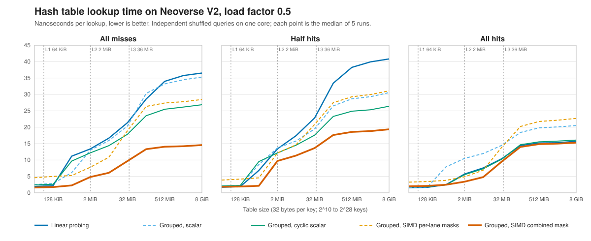

# simd-ht

Three open-addressing hash-table lookups on 64-bit keys, timed on Graviton4 and on Sapphire Rapids. Linear probing is the baseline. The other two search groups of four keys. The cyclic scalar scan checks one key at a time. The SIMD lookup compares all four at once and tests them with one branch.

Each table is half full. From 2 MiB to 8 GiB, SIMD misses (lookups of absent keys) are 2.1-2.8x faster than linear probing, on both CPUs.

Each time is the median of 5 runs, interleaved in random order with the other lookups. The AWS instances ran only this benchmark, on one thread pinned to one CPU. Every run checks its hit count and its value checksum. The largest run-to-run variation is 6.83% on Graviton4 and 12.87% on Sapphire Rapids.

- **With half the lookups hitting, SIMD is 1.4-2.1x faster than linear probing** on Graviton4, and 1.4-2.4x on Sapphire Rapids, from 2 MiB up.
- **Hits gain less.** From 128 MiB up, SIMD hits are 2-3% faster on Graviton4. On Sapphire Rapids, from 2 MiB up, they are 1.2-1.8x faster.
- **Cutting branch mispredictions was not enough to beat the scalar scan.** A SIMD lookup with one mask bit per lane had 0.25 branch mispredictions per miss. It was still 6% slower than the cyclic scalar scan. It ran 45 instructions per miss; the final SIMD lookup runs 29.
- **Linear probing wins on hits in small tables.** At 32 KiB and 128 KiB, with every lookup hitting, it is faster on both CPUs.



The chart shows the three lookups on Graviton4 at every table size.

## The three lookups

All three tables use open addressing: keys and values sit in the table itself, with no buckets. The load factor is 0.5. Key 0 marks an empty slot.

```text
Linear probing: 16-byte cells, four per 64-byte cache line
  | key | value | key | value | key | value | key | value |
  start at cell  hash & (capacity - 1),  then try the next cell

Grouped: one 64-byte group per cache line
  | key 0 | key 1 | key 2 | key 3 | value 0 | value 1 | value 2 | value 3 |
  start at group  (hash & (capacity - 1)) / 4,  then try the next group
```

- **Linear probing** (`ScalarOA`) is the baseline. The lookup starts at the cell the hash selects and tries each next cell. It stops at the key or at an empty cell.
- **Cyclic grouped scan** (`ScalarCyclicGroupedOA`) uses the grouped layout. Each of the 4 key positions is a lane, numbered 0 to 3. The scan starts at lane `hash & 3`, checks one key at a time, and wraps from lane 3 to lane 0.
- **SIMD grouped lookup** (`SIMDGroupedOA`) uses the same groups, and insertion fills the lowest free lane. NEON on Graviton4, or AVX2 on Sapphire Rapids, compares all 4 keys at once. One branch then tests whether any key matched.

## Results

These times are for the 8 GiB table, which holds 2^28 keys. The unit is nanoseconds per lookup, the median of 5 runs. The middle column is half hits and half misses.

The tables range from 32 KiB to 8 GiB. [RESULTS.md](RESULTS.md#results-by-table-size) has every size.

### Graviton4

Four AWS `m8g.4xlarge` instances with Arm Neoverse V2 cores, on 2026-10-09. Clang 22.1.8, NEON, one core.

| | All misses | 50% hits | All hits |
| --- | ---: | ---: | ---: |
| Linear probing (`ScalarOA`) | 36.53 | 40.82 | 15.74 |
| Cyclic grouped scan (`ScalarCyclicGroupedOA`) | 26.87 | 26.39 | 16.08 |
| SIMD grouped lookup (`SIMDGroupedOA`) | 14.57 | 19.36 | 15.30 |

Every hit reads about one cache line, in all three layouts. The all-hit times stay close for that reason.

### Sapphire Rapids

Eight AWS `m7i.4xlarge` instances with the Intel Xeon Platinum 8488C, on 2026-10-09. Clang 22.1.8, AVX2, one logical CPU.

| | All misses | 50% hits | All hits |
| --- | ---: | ---: | ---: |
| Linear probing (`ScalarOA`) | 61.46 | 83.53 | 30.82 |
| Cyclic grouped scan (`ScalarCyclicGroupedOA`) | 58.54 | 67.98 | 29.39 |
| SIMD grouped lookup (`SIMDGroupedOA`) | 28.55 | 34.68 | 23.50 |

[RESULTS.md](RESULTS.md#x86-64) has every table size for this run, and its hardware counters.

## Five designs, one change at a time

These counts are per lookup, for the 8 GiB table with every lookup missing, on Graviton4. Cache lines and key compares come from replaying the lookups. The other counts come from a separate counter run, and the times from the main run.

| Step | Change | Layer | Cache lines | Key compares | Branch mispredictions | Instructions | Cycles | ns |
| --- | --- | --- | ---: | ---: | ---: | ---: | ---: | ---: |
| 1 | Linear probing (`ScalarOA`) | Baseline | 1.375 | 2.50 | 1.42 | 28.50 | 100.6 | 36.53 |
| 2 | Four keys per cache line, scalar scan from lane 0 | Memory layout | 1.228 | 4.91 | 1.36 | 34.68 | 98.4 | 35.31 |
| 3 | Step 2, scan from lane `hash & 3` (`ScalarCyclicGroupedOA`) | Probe order | 1.228 | 2.56 | 1.30 | 34.15 | 75.0 | 26.87 |
| 4 | Step 2, SIMD compare, one mask bit per lane | Branches | 1.228 | 4 per group | 0.25 | 45.17 | 79.5 | 28.46 |
| 5 | Step 4, one combined mask (`SIMDGroupedOA`) | Instructions | 1.228 | 4 per group | 0.29 | 28.97 | 40.5 | 14.57 |

Step 5 is the only step that cut both cache lines and branch mispredictions while keeping about the instruction count of linear probing. Steps 2 and 4 are not in the current source. [RESULTS.md](RESULTS.md#the-five-designs) describes every step.

## Fewer branch mispredictions, without extra instructions

At load factor 0.5, a linear-probing miss compares 2.5 keys on average (Knuth, *The Art of Computer Programming*, Vol. 3, §6.4). The count varies a lot. 50% of misses stop at the first cell. 13.6% of misses need 5 or more cells.

The loop stops on the key or on an empty cell. The CPU often guesses wrong about when the loop will stop. At 8 GiB, each miss has 1.42 branch mispredictions.

Step 4 removed most of those branch mispredictions: it has 0.25 per miss. It was still slower than the cyclic grouped scan. It built a 4-bit mask from the compare results. Building that mask took 8 instructions per group. The lookup then built a second mask to find an empty lane.

Against linear probing, the SIMD lookup differs in branch mispredictions and in cache lines, not in instructions. A SIMD miss runs 28.97 instructions, against 28.50. It has 0.29 branch mispredictions, against 1.42. It reads 1.228 cache lines, against 1.375. Against step 4, it differs mainly in instructions: 28.97 against 45.17.

My reading is that the lookups do not depend on each other. One lookup can be waiting on memory while the core starts later instructions. The core may start only a limited number of those instructions. That limit is the out-of-order window.

Fewer instructions per lookup let more lookups fit in that window. More cache misses can then be in flight at once.

A mispredicted branch throws away the work after it. That includes loads already started for later lookups.

Adding 3 unused `and` instructions to linear probing cost 12.8% at 8 GiB, with all hits. That fits this reading. I have not measured the number of misses in flight.

## How the SIMD probe works

The table never deletes a key, and a key sits in at most one slot. Two properties follow.

1) At most one lane can match. The lookup does not need a separate mask bit for each lane.

Two `cmeq` instructions compare keys 0-1 and keys 2-3. `uzp1` keeps one 32-bit half of each compare result. `xtn` narrows that half to 16 bits per key, in one register. One `cbnz` then tests all 4 keys. Clang 22 generates these instructions for one group.

```asm
ldp   q1, q2, [x15]          // load keys 0-1 and keys 2-3
cmeq  v1.2d, v1.2d, v0.2d    // keys 0-1 == search key: all ones or all zeros per lane
cmeq  v2.2d, v2.2d, v0.2d    // keys 2-3 == search key
uzp1  v1.4s, v1.4s, v2.4s    // keep one 32-bit half of each result
xtn   v1.4h, v1.4s           // narrow to one 16-bit field per key
fmov  x14, d1                // move the four fields to one general register
cbnz  x14, hit               // one branch for four keys
```

A match in lane `i` leaves `48 - 16 * i` leading zeros in that register. The values sit in order, 8 bytes each. Half the leading-zero count is therefore the distance in bytes from value 3 back to value `i`. Here the search key is in lane 1:

```text
keys        | k0     | k1     | k2     | 0      |   search key k1
cmeq        | 0      | ones   | 0      | 0      |   64 bits per lane
narrowed    | 0x0000 | 0xffff | 0x0000 | 0x0000 |   16 bits per lane, lane 0 lowest
clz         32                                      48 - 16 * 1
value       &values[3] - 32 / 2 bytes  =  &values[1]
```

2) Insertion fills the lowest free lane. A group with any free lane therefore has lane 3 free. When no lane matches, the lookup reads `keys[3]`, and a 0 there means the key is absent. 83.7% of groups are not full, so this branch nearly always goes the same way.

The home group is the first group the hash selects. A hit that stops there runs 29 instructions, and a miss that stops there runs 26. Both counts include the hash and the benchmark loop. Each further full group adds 13 instructions.

On x86-64, one `vpcmpeqq` compares all 4 keys, and `vmovmskpd` moves the result to a general-purpose register. There I keep the probe position as a byte offset, because x86 addressing cannot scale a group index by 64.

The code is in [`src/hash_tables.hpp`](src/hash_tables.hpp). It uses only the vector types built into Clang, with no separate SIMD library.

## How the numbers were checked

- Every timed run checks its hit count and its value checksum, and fails on a mismatch.
- The tests check every lookup against a reference table, including full groups, wraparound, and keys that share a first slot. They pass under AddressSanitizer and UndefinedBehaviorSanitizer.
- Each case ran 5 times. Every lookup of one table row ran on the same instance, in one random order.
- One binary went unchanged to every instance of a run. The current source compiles to the same timed loops as the measured Graviton4 binary.
- Hardware counters come from a separate run, because reading them adds time.
- At 2 MiB, two builds that place the same loops at different addresses agree within 0.4% on misses.

[RESULTS.md](RESULTS.md#how-the-results-were-checked) has the details.

## Caveats

- Every run used Clang 22.1.8, one key distribution, and a load factor of 0.5.

- The benchmark measures throughput: a stream of lookups that do not depend on each other. It does not measure the latency of one lookup alone.

- Below 2 MiB, the results are mixed.

- At 32 KiB and at 128 KiB, the branch predictor learns the query trace, the list of keys to look up. Linear probing is then faster on hits.

- At 512 KiB, the time depends on where the loop sits in memory. Two builds use the same loop instructions. On misses, linear probing differs by 39% between those builds. Their times were compared only at 512 KiB and 2 MiB.

- The out-of-order explanation above is an inference. No counter here measures misses in flight, and the control experiment used hits only.

- The table is insert-only. The `keys[3]` test does not work if a key can be deleted.

- The counters do not split the gain over linear probing between fewer branch mispredictions and fewer cache lines.

## Build

The code is C++20, built with Clang, Meson, Ninja, and CMake. Meson selects NEON on AArch64 and AVX2 on x86-64.

```sh
CXX=clang++-22 meson setup build --buildtype=release
meson compile -C build
meson test -C build
taskset -c 8 build/oa_bench --benchmark_min_time=0.1s --benchmark_repetitions=5 \
    --benchmark_enable_random_interleaving=true
```

The full run takes about 45 minutes. It needs memory for an 8 GiB table plus a 2 GiB query trace.

The exact commands for the published numbers are in [RESULTS.md](RESULTS.md#reproduce).

## License

The license is the [Apache License 2.0](LICENSE).
